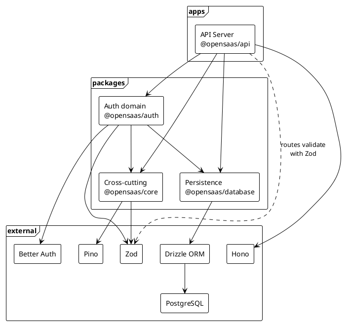
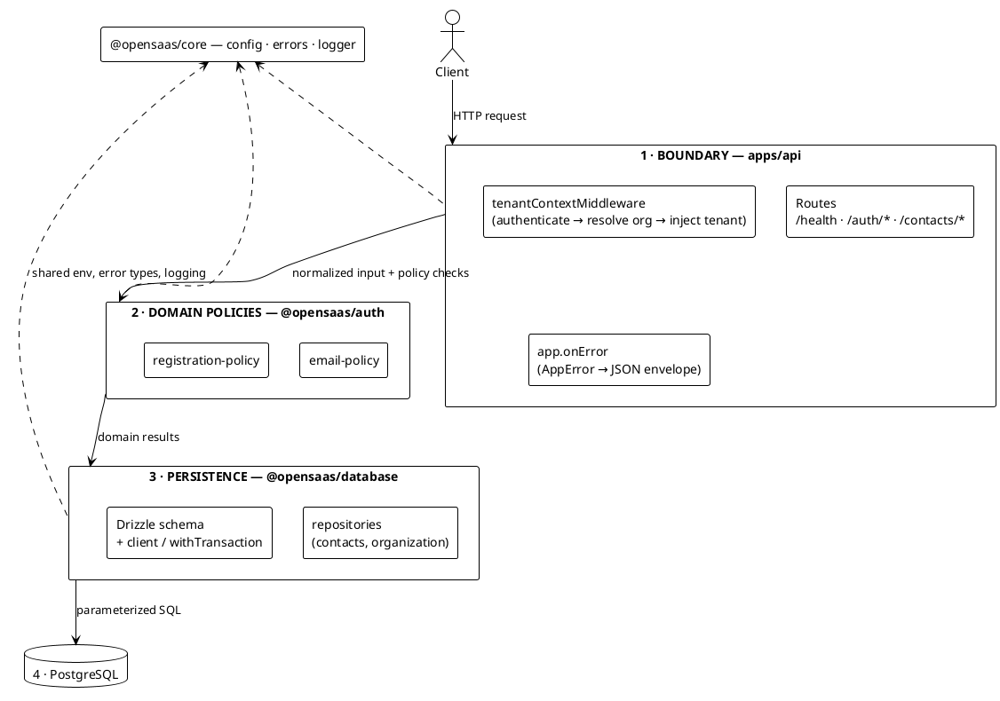
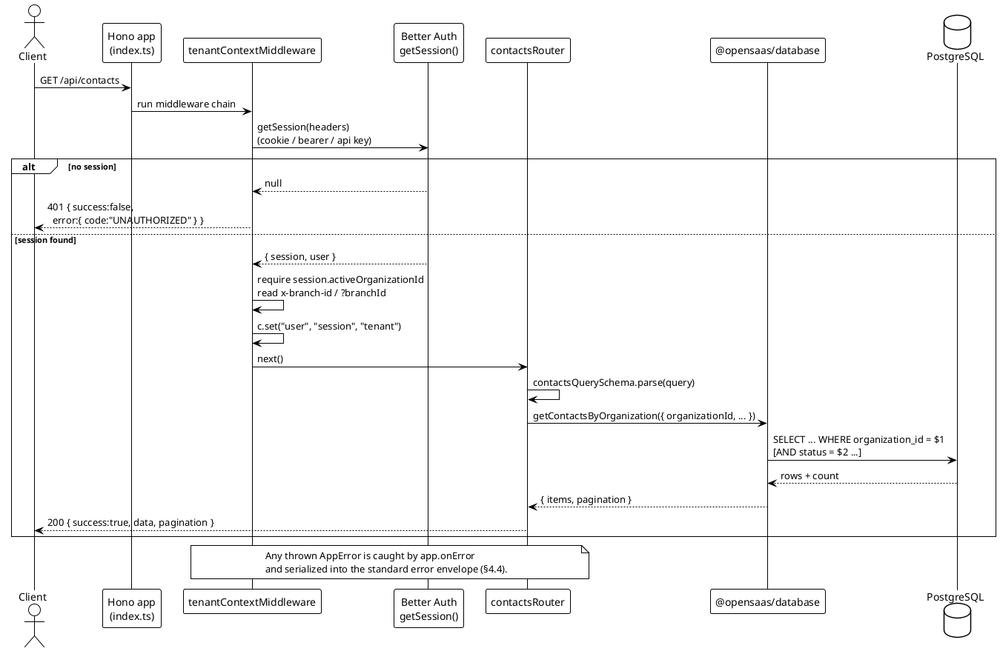
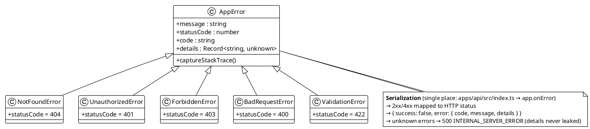
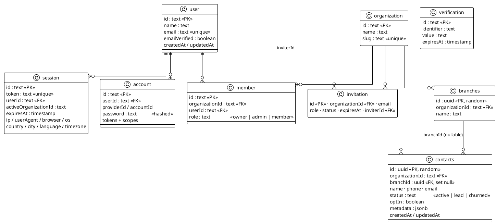
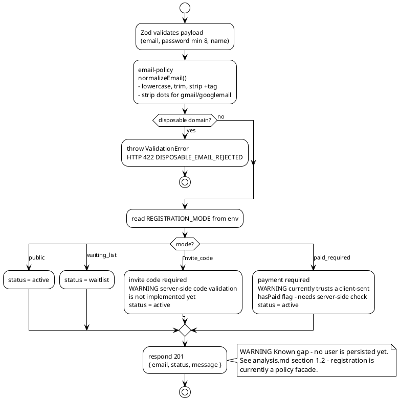
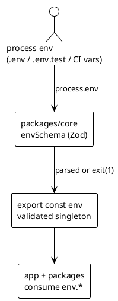

# Technical Overview — open-saas-api

> Audience: software developers, coding agents, and open-source collaborators.
> Companion document: [analysis.md](./analysis.md) (production-readiness audit with known gaps).

---

## 1. What is this project?

**open-saas-api** is a modular, multi-tenant SaaS automation engine built with **Bun**, **Hono**, and **Drizzle ORM**. It provides the foundation for a SaaS product where multiple organizations (tenants) share one database but their data is strictly isolated, with authentication, organization membership, and a first CRM domain module (contacts/branches).

**Current scope (what actually works today):**

- Multi-tenant foundations: organizations, members, branches, contacts
- Health check endpoint (`GET /api/health`)
- Registration policy engine (email anti-abuse + registration modes)
- Persistence layer with Drizzle schema for Better Auth + business tables
- Monorepo toolchain: Biome (lint/format), commitlint, Husky, release-it, GitHub Actions CI

**Planned scope (roadmap, not implemented):** channel automation (WhatsApp/email routing), payment integration, full auth HTTP surface. See §11 for known gaps.

---

## 2. Tech stack

| Layer | Technology |
| --- | --- |
| Runtime | [Bun](https://bun.sh) |
| HTTP framework | [Hono](https://hono.dev) |
| ORM | [Drizzle ORM](https://orm.drizzle.team) (PostgreSQL / postgres-js driver) |
| Authentication | [Better Auth](https://www.better-auth.com) (email+password, organization & bearer plugins) |
| Validation | Zod (at every HTTP boundary) |
| Logging | Pino (`pino-pretty` in development) |
| Lint / Format | Biome |
| Commits / Release | commitlint (conventional) + Husky + release-it |
| CI | GitHub Actions (Postgres 16 service container) |

---

## 3. Repository structure

Bun workspaces monorepo: `apps/*` contains deployable applications, `packages/*` contains shared libraries.

```
open-saas-api/
├── apps/
│   └── api/                      # HTTP entrypoint (@opensaas/api)
│       └── src/
│           ├── index.ts          # Hono app, health route, global error handler, server boot
│           ├── types.ts          # AppEnv / AppVariables (typed Hono context)
│           ├── middleware/
│           │   └── tenant.ts     # session → active organization → tenant context
│           ├── routes/
│           │   ├── auth.ts       # POST /api/auth/register (policy validation)
│           │   └── contacts.ts   # GET/POST /api/contacts, POST /api/contacts/bulk
│           └── __tests__/        # integration tests (HTTP via app.fetch)
├── packages/
│   ├── core/                     # @opensaas/core — cross-cutting concerns
│   │   └── src/
│   │       ├── config.ts         # Zod-validated env singleton (`env`)
│   │       ├── errors.ts         # AppError hierarchy + API response types
│   │       └── logger.ts         # Pino logger singleton
│   ├── auth/                     # @opensaas/auth — auth domain logic
│   │   └── src/
│   │       ├── auth.ts           # Better Auth instance (drizzle adapter, org + bearer plugins)
│   │       ├── email-policy.ts   # normalization + disposable-domain blocking
│   │       ├── registration-policy.ts  # registration modes (strategy logic)
│   │       └── telemetry.ts      # header/UA/geo extraction for sessions
│   └── database/                 # @opensaas/database — persistence
│       └── src/
│           ├── client.ts         # drizzle client, Transaction type, withTransaction()
│           ├── schema.ts         # Drizzle schema (Better Auth + business tables)
│           ├── contacts.ts       # contacts repository functions
│           ├── health.ts         # checkDatabaseHealth()
│           └── repositories/
│               └── organization.ts
├── .github/workflows/ci.yml      # lint → typecheck → db push → test
├── biome.json / commitlint.config.mjs / .release-it.json
└── docs/
    └── v1/
        ├── analysis.md               # production-readiness audit
        └── technical-overview.md     # this document
```

---

## 4. Architecture

### 4.1 Package dependency map

Packages are layered: `api` depends on domain packages; `auth` depends on `core` + `database`; nothing depends on `api`.



### 4.2 Layered view (as-is request processing)



**Layering rules:**

1. **Routes** are thin: parse/validate input (Zod), call domain/persistence, serialize the response envelope. No business rules in handlers.
2. **Domain policies** (`@opensaas/auth`) are pure functions: input → result or typed error. No HTTP or DB concerns.
3. **Persistence** (`@opensaas/database`) owns SQL and rows. Every tenant-scoped query must filter by `organizationId`.
4. **Cross-cutting** (`@opensaas/core`) is the only place that reads/validates environment config and defines error types.

### 4.3 Request lifecycle (authenticated endpoint)



### 4.4 Error handling & API contract

All responses follow one envelope:

- **Success:** `{ "success": true, "data": <payload>, "pagination"?: {...} }`
- **Error:** `{ "success": false, "error": { "code": string, "message": string, "details"?: unknown } }`

Errors are thrown as typed exceptions from anywhere in the stack and serialized once, centrally, by `app.onError`:



---

## 5. Multi-tenancy model

Every tenant-scoped resource hangs off an **organization**. A user reaches an organization through an active **membership**; a session carries `activeOrganizationId`.

**Isolation invariants (enforced — or to be enforced — at each layer):**

| Layer | Mechanism |
| --- | --- |
| HTTP | `tenantContextMiddleware` requires a session **and** an `activeOrganizationId`; injects `tenant = { organizationId, branchId }` into the Hono context |
| Repository | every query includes `WHERE organization_id = $1`; input `organizationId` always comes from the tenant context, never from the client body |
| Database | FKs (`contacts.organization_id → organization.id`) + `ON DELETE CASCADE`; optional future hardening: Postgres RLS |
| Membership | `member` table links users ↔ organizations with a role (`owner`/`admin`/`member`) |

> ⚠️ Membership verification and branch-ownership checks are **not yet implemented** — see [analysis.md §1.5](./analysis.md#15-multi-tenant-isolation-broken-on-writes).

---

## 6. Data model

Two groups of tables: **Better Auth managed** (auth + organization plugin) and **business tables** (branches, contacts).



**Notes for contributors:**

- Better Auth owns table names/shape for `user`, `session`, `account`, `verification`, `organization`, `member`, `invitation` — do not rename columns without checking Better Auth's schema requirements.
- Business tables use `uuid` PKs; Better Auth tables use `text` PKs (framework-generated ids).
- Schema changes: edit `packages/database/src/schema.ts`, then `bun --filter @opensaas/database db:generate` (migration files) — see §9.

---

## 7. Authentication & registration

### 7.1 Session authentication

The Better Auth instance (`packages/auth/src/auth.ts`) wires the Drizzle adapter to our schema, with the `organization()` plugin (orgs, members, invitations, `activeOrganizationId` on sessions) and the `bearer()` plugin (stateless requests). `tenantContextMiddleware` then resolves the session from cookies/bearer/API-key headers on every tenant-scoped request.

### 7.2 Registration flow (policy engine)

`POST /api/auth/register` validates the payload, normalizes/blocks the email, then applies the configured **registration mode**:



### 7.3 Registration modes as an extension point

`RegistrationMode = "public" | "waiting_list" | "invite_code" | "paid_required"` is defined in `packages/auth/src/registration-policy.ts`. Adding a mode = add a union member + a `switch` branch (target: refactor into a strategy registry — see analysis.md §3).

---

## 8. Configuration & environment

Single source of truth: `envSchema` in `packages/core/src/config.ts`, parsed once at startup; invalid config **fails fast** (`process.exit(1)` with a formatted report).



| Variable | Required | Notes |
| --- | --- | --- |
| `NODE_ENV` | – | `development` \ | `production` \ | `test` (default `development`) |
| `PORT` | – | default `3000` |
| `LOG_LEVEL` | – | default `info` |
| `DATABASE_URL` | ✅ | PostgreSQL connection string |
| `BETTER_AUTH_SECRET` | ✅ | ≥ 32 chars |
| `BETTER_AUTH_URL` | ✅ | base URL of the API |
| `DISPOSABLE_EMAIL_DOMAINS` | – | comma-separated extra blocked domains |
| `REGISTRATION_MODE` | – | `public` (default) \ | `waiting_list` \ | `invite_code` \ | `paid_required` |

**Convention:** always read configuration via `import { env } from "@opensaas/core"` — never `process.env` directly. New variables must be added to `envSchema` **and** `.env.example`. (Known debt: a few `process.env` reads still exist — analysis.md §2.3.)

---

## 9. Development workflow

### 9.1 Commands

```bash
bun install                     # install workspace deps
bun run dev                     # run API with --watch (apps/api)
bun run lint                    # biome check .
bun run format                  # biome format --write .
bun run typecheck               # tsc --noEmit in every package
bun test                        # run all tests (needs DATABASE_URL for DB tests)

# database (packages/database)
bun --filter @opensaas/database db:generate   # emit SQL migrations from schema diff
bun --filter @opensaas/database db:migrate    # apply migrations
bun --filter @opensaas/database db:push       # dev: push schema directly
bun --filter @opensaas/database db:studio     # Drizzle Studio

bun run release                 # release-it: lint+typecheck+test → changelog → tag
```

### 9.2 Setup

```bash
cp .env.example .env    # fill DATABASE_URL / BETTER_AUTH_SECRET
bun install
bun --filter @opensaas/database db:push   # or db:migrate
bun run dev
```

### 9.3 Testing

- Framework: `bun test`; tests live in `__tests__/` folders (plus a couple of colocated `*.test.ts` — legacy; keep new tests in `__tests__/`).
- **Unit tests:** pure domain logic (policies, errors) — no DB.
- **Integration tests:** use a real Postgres (CI spins up a `postgres:16-alpine` service). Tenant-isolation tests create uniquely-suffixed orgs to avoid collisions.
- HTTP-level tests call `app.fetch(new Request(...))` — no network port needed.

### 9.4 CI (GitHub Actions)

`lint → typecheck → db:push → test` on push/PR to `main`.
> ⚠️ Known bug: the `db:push` step is malformed (`run:` nested under `env:`) so the schema is not pushed — analysis.md §1.6.

### 9.5 Git conventions

- **Conventional Commits** enforced by commitlint (`feat:`, `fix:`, `docs:`, `refactor:`, `test:`, `chore:`…).
- Husky `pre-commit` runs `bun test`.
- PRs go through review; release via `bun run release` (release-it + conventional changelog → `CHANGELOG.md` + git tag).

---

## 10. Extension guide (how to add things)

### 10.1 Add an endpoint

1. Create/extend a router in `apps/api/src/routes/<resource>.ts` with `new Hono<AppEnv>()`.
2. Attach `tenantContextMiddleware` (`router.use("*", tenantContextMiddleware)`) for tenant-scoped routes.
3. Define a Zod schema for query/body; parse **before** touching the repository (use `zValidator` or `safeParse` → `throw new ValidationError(...)`).
4. Call a repository/domain function — pass `tenant.organizationId` explicitly; never trust ids from the payload.
5. Return the envelope: `c.json({ success: true, data })` (add `201` on create).
6. Register the router in `apps/api/src/index.ts`: `app.route("/api/<resource>", router)`.
7. Add an integration test in `apps/api/src/__tests__/`.

### 10.2 Add a table / change schema

1. Edit `packages/database/src/schema.ts` (naming: snake_case columns, `withTimezone` timestamps, FKs with explicit `onDelete`).
2. Generate a migration: `bun --filter @opensaas/database db:generate` and commit the SQL under `packages/database/drizzle/`.
3. Add repository functions in `packages/database/src/repositories/` (keep repository modules consistent — new ones go in this folder).
4. Every tenant-scoped query **must** filter by `organizationId`.

### 10.3 Add a cross-cutting concern

Config var → `packages/core/src/config.ts` (`envSchema`) + `.env.example`.
New error type → extend `AppError` in `packages/core/src/errors.ts`.
New middleware → `apps/api/src/middleware/`, compose it in `index.ts` or the router.

### 10.4 Coding standards

- TypeScript `strict` everywhere; prefer domain types over `any` (`z.record(z.any())` is a known exception to avoid in new code).
- Throw typed `AppError` subclasses — never hand-roll error JSON in handlers (one exception exists today: `routes/auth.ts` local catch; prefer `onError`).
- No `process.env` reads outside `core/config.ts`.
- Naming: kebab-case files, PascalCase classes, camelCase functions; imports organized by Biome.
- Keep routes thin; put decisions in `@opensaas/auth` (pure policy) or `@opensaas/database` (persistence).
- Every new behavior ships with tests (unit for policies, integration for routes/queries).

---

## 11. Known gaps & further reading

This document describes the architecture **as-is**. For a prioritized list of defects, missing patterns, security items, and the P0/P1/P2 roadmap, read [analysis.md](./analysis.md) — key items:

- Better Auth HTTP handler is not mounted (§1.1) — sign-in/sign-up endpoints don't exist yet
- Registration does not persist users (§1.2)
- Membership/branch ownership not verified in tenant middleware (§1.5)
- CI `db:push` step broken (§1.6)
- Missing security middleware: CORS, rate limiting, security headers (§5)
