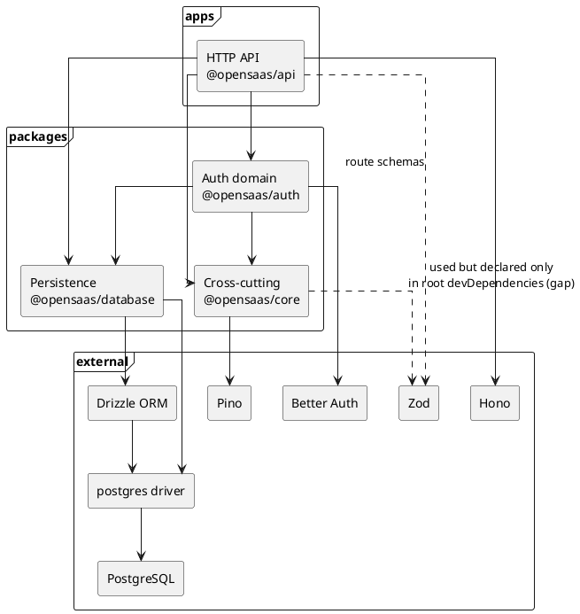
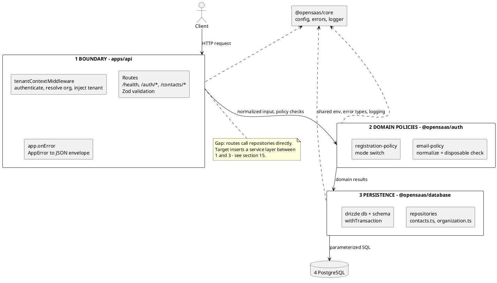
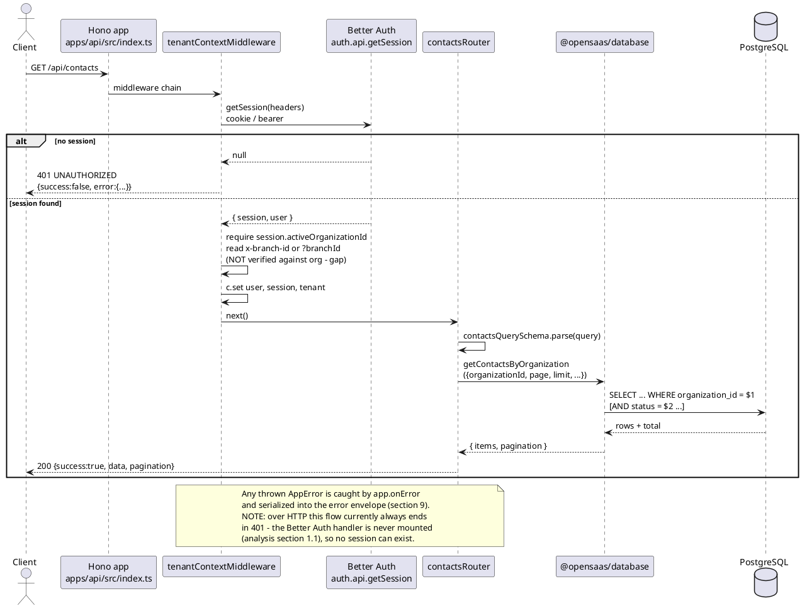
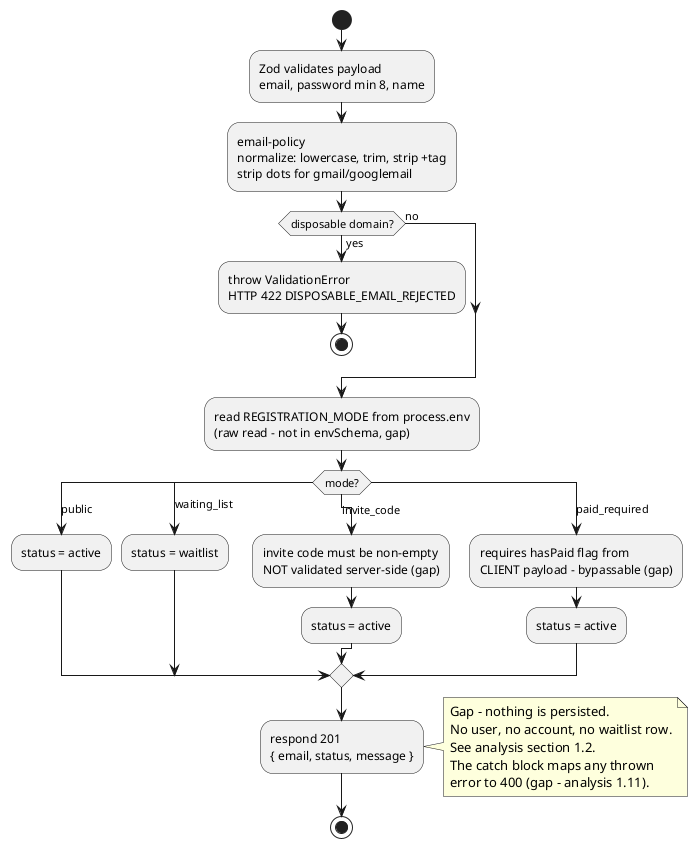
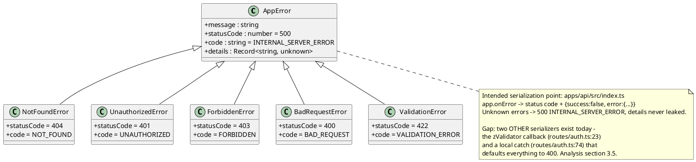
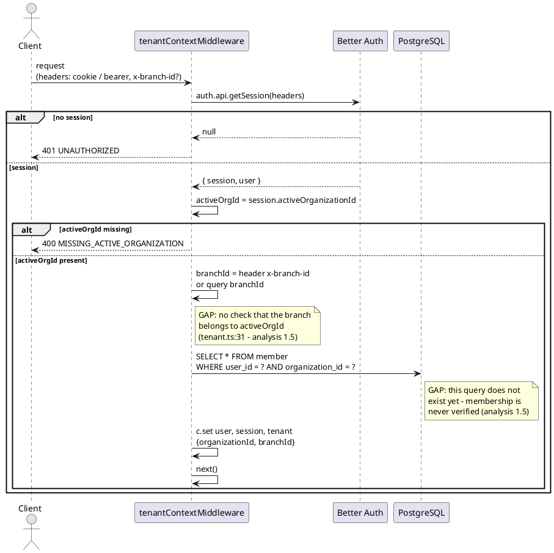
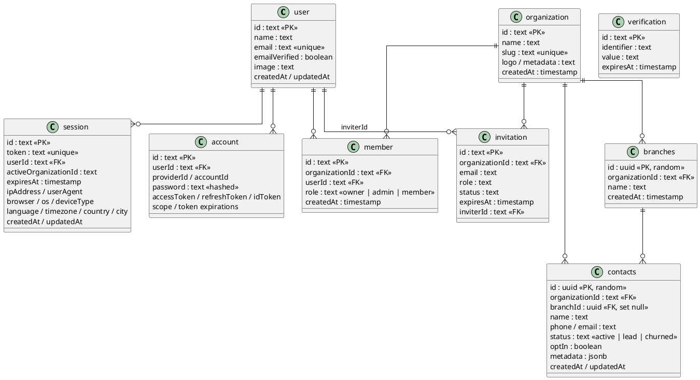
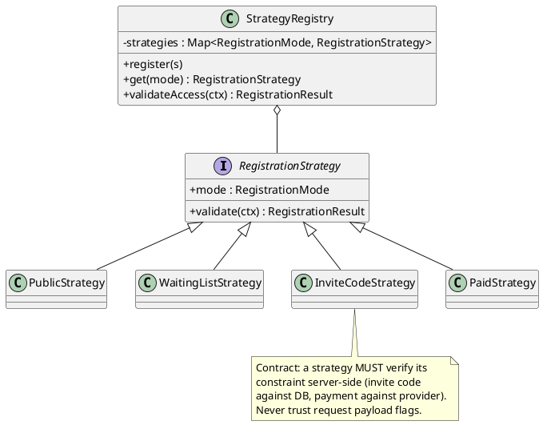
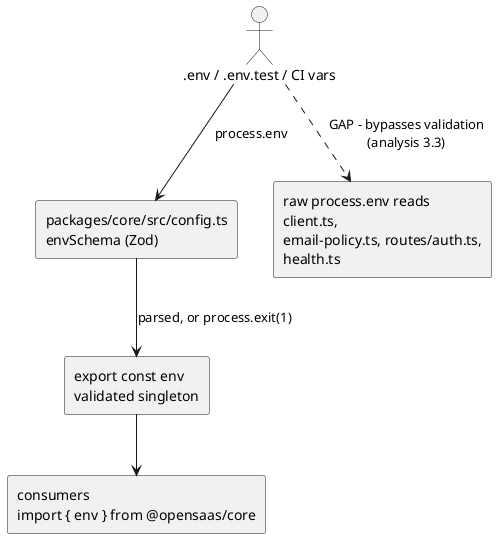
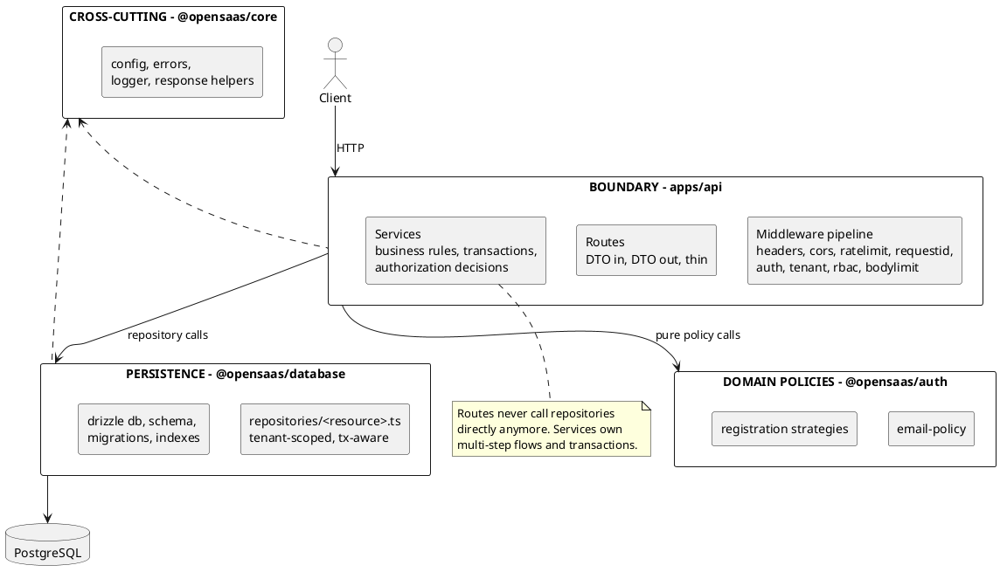

# Architecture — open-saas-api (v3)

> **Audience:** software developers, coding agents, and open-source collaborators who want to extend or customize this project.
> **Companion documents:**
> - [Production Readiness Analysis](../v2/analysis.md) — verified audit of every defect, with `file:line` evidence.
> - [Roadmap](../v2/roadmap.md) — prioritized plan (P0–P3) with acceptance criteria.
> - Historical: [v1/technical-overview.md](../v1/technical-overview.md), [v1/analysis.md](../v1/analysis.md).
>
> **Status badges.** Every factual section is labeled:
> - **Status: as-is** — describes the code as it exists today.
> - **Status: target state** — the intended design; not implemented yet.
> - **Status: as-is + target state** — both, explicitly separated.
>
> Never treat a target-state description as something you can rely on at runtime. When this document and the source disagree, the source wins — then fix this document.

---

## Table of contents

1. [Purpose and how to read this document](#1-purpose-and-how-to-read-this-document)
2. [System overview](#2-system-overview)
3. [Technology stack](#3-technology-stack)
4. [Repository layout](#4-repository-layout)
5. [Workspace architecture](#5-workspace-architecture)
6. [Request processing layers](#6-request-processing-layers)
7. [Request lifecycle](#7-request-lifecycle)
8. [Registration flow](#8-registration-flow)
9. [Response and error contract](#9-response-and-error-contract)
10. [Multi-tenancy model](#10-multi-tenancy-model)
11. [Data model](#11-data-model)
12. [Authentication and registration modes](#12-authentication-and-registration-modes)
13. [Configuration management](#13-configuration-management)
14. [Extension playbooks](#14-extension-playbooks)
15. [Target state architecture](#15-target-state-architecture)
16. [Known gaps and risks](#16-known-gaps-and-risks)
17. [Development workflow, testing and CI](#17-development-workflow-testing-and-ci)
18. [Coding standards and conventions](#18-coding-standards-and-conventions)
19. [Appendix](#19-appendix)

---

## 1. Purpose and how to read this document

**Status: as-is (documentation)**

This is the architectural reference for `open-saas-api`. It explains how the system is put together today, where the boundaries are, how to add things without breaking multi-tenant isolation, and what the intended (target) design looks like.

**For coding agents:**

- Sections 5–11 describe **facts** — read them before touching code. They carry `file:line` references you can jump to.
- Section 14 is the set of **recipes** for common changes. Follow them exactly; they encode the project's conventions.
- Section 15 is **target state** — a design you may implement, but must not assume exists.
- Section 16 links to the verified defect list. If your change touches that area, read the linked analysis section first; you may be asked to fix it as part of the change.
- When adding behavior: routes stay thin, policies live in `@opensaas/auth`, persistence lives in `@opensaas/database`, cross-cutting config/errors/logging live in `@opensaas/core`.

**Document map:**

| Question | Where |
| --- | --- |
| What does the code do today? | §5–§13, §17 |
| How do I add an endpoint/table/mode/middleware? | §14 |
| What should the design become? | §15 |
| What is broken and why? | [../v2/analysis.md](../v2/analysis.md), summarized in §16 |
| In what order do I fix things? | [../v2/roadmap.md](../v2/roadmap.md) |

---

## 2. System overview

**Status: as-is**

**open-saas-api** is a modular, multi-tenant SaaS automation engine built with **Bun**, **Hono**, and **Drizzle ORM**. Multiple organizations (tenants) share one PostgreSQL database while their data stays isolated. The platform provides authentication and organization membership (via Better Auth) plus a first business domain module: a CRM base of contacts and branches.

**What actually works today:**

- Health endpoint (`GET /api/health`) with a database roundtrip.
- Multi-tenant foundations: organizations, members, branches, contacts tables + tenant-scoped contact queries.
- Registration **policy** engine (email normalization/anti-abuse + four registration modes) exposed at `POST /api/auth/register`.
- Persistence layer (Drizzle schema for Better Auth + business tables).
- Monorepo toolchain: Biome, commitlint, Husky, release-it, GitHub Actions CI.

**What is scaffolded but not wired (see** [analysis](../v2/analysis.md)**):** the Better Auth HTTP surface is never mounted, registration does not persist anything, session telemetry is dead code, RBAC roles exist but are never enforced. See [§16](#16-known-gaps-and-risks).

**Planned scope:** channel automation (WhatsApp/email routing), payments, full auth surface — tracked in the roadmap, not implemented.

---

## 3. Technology stack

**Status: as-is**

| Layer | Technology | Where |
| --- | --- | --- |
| Runtime | Bun | root `package.json` |
| HTTP framework | Hono 4.x | `apps/api` |
| Request validation | Zod + `@hono/zod-validator` | routes |
| ORM | Drizzle ORM (postgres-js driver) | `packages/database` |
| Database | PostgreSQL 16 | CI service, `.env` |
| Authentication | Better Auth (email+password; `organization` + `bearer` plugins) | `packages/auth` |
| Logging | Pino (`pino-pretty` in development) | `packages/core` |
| Lint / format | Biome | `biome.json` |
| Commits / release | commitlint + Husky + release-it | root |
| CI | GitHub Actions | `.github/workflows/ci.yml` |

---

## 4. Repository layout

**Status: as-is**

Bun workspaces monorepo: `apps/*` holds deployable applications, `packages/*` holds shared libraries, `docs/*` holds versioned documentation.

```
open-saas-api/
├── apps/
│   └── api/                          # @opensaas/api — HTTP entrypoint
│       └── src/
│           ├── index.ts              # Hono app, health route, router mount, global onError, server boot
│           ├── types.ts              # AppEnv / AppVariables (typed Hono context)
│           ├── middleware/
│           │   └── tenant.ts         # session → active organization → tenant context
│           ├── routes/
│           │   ├── auth.ts           # POST /api/auth/register (policy facade)
│           │   └── contacts.ts       # GET/POST /api/contacts, POST /api/contacts/bulk
│           └── __tests__/            # HTTP integration tests via app.fetch()
├── packages/
│   ├── core/                         # @opensaas/core — cross-cutting concerns
│   │   └── src/
│   │       ├── config.ts             # Zod envSchema + validated `env` singleton (fails fast)
│   │       ├── errors.ts             # AppError hierarchy + ApiResponse envelope types
│   │       ├── logger.ts             # Pino logger singleton
│   │       └── errors.test.ts
│   ├── auth/                         # @opensaas/auth — auth domain logic
│   │   └── src/
│   │       ├── auth.ts               # betterAuth() instance + drizzle adapter + plugins
│   │       ├── email-policy.ts       # normalization + disposable-domain blocking
│   │       ├── registration-policy.ts# RegistrationMode switch (strategy logic)
│   │       ├── telemetry.ts          # header/UA/geo extraction (currently unused)
│   │       └── __tests__/            # policy + telemetry unit tests
│   └── database/                     # @opensaas/database — persistence
│       └── src/
│           ├── client.ts             # postgres client, drizzle `db`, Transaction, withTransaction()
│           ├── schema.ts             # Drizzle schema (7 Better Auth tables + 2 business tables)
│           ├── contacts.ts           # contacts repository (root-level functions)
│           ├── health.ts             # checkDatabaseHealth()
│           ├── repositories/
│           │   └── organization.ts   # organization repository (folder convention)
│           └── __tests__/
├── docs/
│   ├── v1/                           # first-pass docs (kept for history)
│   ├── v2/                           # verified analysis + roadmap (companion docs)
│   └── v3/                           # this document
├── .github/workflows/ci.yml          # lint → typecheck → db push → test
├── biome.json / commitlint.config.mjs / .release-it.json / tsconfig.json
└── .env.example                      # environment template
```

---

## 5. Workspace architecture

**Status: as-is**

### 5.1 Package dependency map

Packages are layered: `api` composes everything; `auth` depends on `core` + `database`; `database` and `core` depend on nothing internal. Nothing may depend on `apps/api`.



### 5.2 Dependency rules

1. `apps/api` may import from all three packages. Nothing imports `apps/api`.
2. `@opensaas/auth` may import `@opensaas/core` and `@opensaas/database`.
3. `@opensaas/database` and `@opensaas/core` must stay free of internal workspace imports — they are the leaves.
4. No cycles. If you need `core` from `database`, the design is wrong: move the shared type instead.
5. Workspace packages are referenced as `"@opensaas/<name>": "workspace:*"` and resolved through `main`/`module` pointing at `./src/index.ts` (no build step; Bun consumes TypeScript directly).

### 5.3 Responsibilities per package

| Package | Owns | Must not contain |
| --- | --- | --- |
| `@opensaas/api` | HTTP surface: routing, middleware composition, request/response DTOs (Zod), serialization | business rules, SQL |
| `@opensaas/auth` | pure domain policies (email, registration), Better Auth wiring, telemetry extraction | HTTP objects, SQL |
| `@opensaas/database` | schema, queries, transactions, repositories | HTTP, policy decisions |
| `@opensaas/core` | env validation, error types, logger | anything domain-specific |

---

## 6. Request processing layers

**Status: as-is + target state**

### 6.1 Current processing path (as-is)

Today the flow is `route → repository` (plus pure policy functions called from the route). There is **no service layer** — see [analysis §3.1](../v2/analysis.md).



### 6.2 Layering rules (as-is, mandatory)

1. **Routes** parse and validate input (Zod), pull the tenant context, call a repository or policy function, and serialize the envelope. No business rules, no raw SQL.
2. **Domain policies** (`@opensaas/auth`) are pure functions: input → result or typed `AppError`. No HTTP, no DB.
3. **Persistence** (`@opensaas/database`) owns SQL and rows. Every tenant-scoped query **must** filter by `organizationId`.
4. **Cross-cutting** (`@opensaas/core`) is the only place allowed to validate environment config and define error types.

---

## 7. Request lifecycle

**Status: as-is**

How an authenticated tenant-scoped request flows, e.g. `GET /api/contacts`:



**Key facts:**

- Middleware is attached per-router: `contactsRouter.use("*", tenantContextMiddleware)` (`apps/api/src/routes/contacts.ts:14`). The health and register routes have **no** tenant middleware.
- Session resolution (`apps/api/src/middleware/tenant.ts:7`) accepts cookies or Bearer tokens (the `bearer()` plugin is installed on the Better Auth instance).
- The global error boundary is `app.onError` (`apps/api/src/index.ts:38`).
- There is **no** `app.notFound()` — unknown routes return Hono's plain-text 404, breaking the JSON contract ([analysis §3.5](../v2/analysis.md)).

---

## 8. Registration flow

**Status: as-is**

`POST /api/auth/register` validates the payload, normalizes/blocks the email, then applies the configured registration mode. **It does not persist anything** ([analysis §1.2](../v2/analysis.md)) — it is a policy facade.



---

## 9. Response and error contract

**Status: as-is**

### 9.1 Envelope

Every JSON response follows one contract (types in `packages/core/src/errors.ts:54-68`):

```json
{ "success": true, "data": <payload>, "pagination": { "page": 1, "limit": 20, "total": 0, "totalPages": 0 } }
```

```json
{ "success": false, "error": { "code": "VALIDATION_ERROR", "message": "...", "details": {} } }
```

`pagination` is only present on list endpoints (currently `GET /api/contacts`).

### 9.2 Error hierarchy



### 9.3 Rules for new code

- **Throw** typed `AppError` subclasses; never hand-roll error JSON inside a handler.
- Let `app.onError` be the single serializer (the local `catch` in `routes/auth.ts` is a known exception being removed — [analysis §1.11](../v2/analysis.md)).
- Use `error.code` (stable, SCREAMING_SNAKE) for programmatic handling; `message` is human-facing and may change.
- Never leak internal details in `details` for 500-class errors.

---

## 10. Multi-tenancy model

**Status: as-is (with explicit gaps)**

Every tenant-scoped resource hangs off an **organization**. A user reaches an organization through a membership; the session carries `activeOrganizationId`.

### 10.1 Context resolution



### 10.2 Isolation invariants by layer

| Layer | Mechanism | Enforced today? |
| --- | --- | --- |
| HTTP | `tenantContextMiddleware` requires a session and an `activeOrganizationId`; injects `tenant = { organizationId, branchId }` into the Hono context | ✅ partially (session can never exist over HTTP — [§16](#16-known-gaps-and-risks)) |
| Route | `organizationId` always comes from `tenant`, never from the request body | ✅ (`routes/contacts.ts`) |
| Repository | every query includes `WHERE organization_id = $1` | ✅ for contacts reads/writes |
| Branch ownership | `branchId` verified to belong to the organization | ❌ not implemented ([analysis §1.5](../v2/analysis.md)) |
| Membership | `member` table consulted before tenant actions | ❌ never queried ([analysis §1.5](../v2/analysis.md)) |
| RBAC | `owner` / `admin` / `member` roles enforced | ❌ roles exist (`schema.ts:128`), never read |
| Database | FK `contacts.organization_id → organization.id` + `ON DELETE CASCADE`; future: Postgres RLS | ✅ FK only |

**Contributor rule:** if your change adds a tenant-scoped query, the `organizationId` filter is non-negotiable, and any id that comes from the client (`branchId` in particular) must be verified against the caller's organization before use.

---

## 11. Data model

**Status: as-is**

Two groups: **Better Auth managed** tables (framework contract — do not rename columns) and **business tables** (ours to evolve).



### 11.1 Table ownership

| Table | Owner | Source |
| --- | --- | --- |
| `user`, `session`, `account`, `verification` | Better Auth core | `schema.ts:13,30,65,94` |
| `organization`, `member`, `invitation` | Better Auth `organization` plugin | `schema.ts:106,120,137` |
| `branches`, `contacts` | this project | `schema.ts:157,171` |

### 11.2 Rules for contributors

- Better Auth owns the name and shape of its seven tables. Renaming a column there breaks the adapter; check Better Auth's schema requirements first.
- Better Auth tables use `text` PKs (framework-generated ids); business tables use `uuid` PKs with `defaultRandom()`.
- All timestamps are `timestamp with time zone` with `defaultNow()`.
- Every tenant-scoped table carries `organizationId` with `ON DELETE CASCADE`.
- Schema change workflow: edit `packages/database/src/schema.ts` → `bun --filter @opensaas/database db:generate` → commit SQL ([§14.3](#143-add--change-a-table)).
- Known deficiencies: no indexes on `contacts(organizationId, status)` / `(organizationId, branchId)`, no CHECK/enum on `contacts.status`, `updatedAt` is never maintained, `organization.metadata` is `text` while `contacts.metadata` is `jsonb` ([analysis §2.5, §3.7](../v2/analysis.md)).

---

## 12. Authentication and registration modes

**Status: as-is + target state**

### 12.1 Better Auth instance (as-is)

`packages/auth/src/auth.ts:7` creates one `betterAuth(...)` instance:

- **Adapter:** `drizzleAdapter(db, { provider: "pg", schema })` mapped to our Drizzle tables.
- **Secret/baseURL:** `env.BETTER_AUTH_SECRET`, `env.BETTER_AUTH_URL`.
- **`emailAndPassword.enabled: true`** — credential login is intended.
- **Plugins:**
  - `organization()` — orgs, members, invitations, `session.activeOrganizationId`.
  - `bearer()` — stateless requests via `Authorization: Bearer`.
- **Never mounted:** the instance exists, but `app.all("/api/auth/*", (c) => auth.handler(c.req.raw))` is absent from `apps/api/src/index.ts`, so no sign-in/sign-up/session endpoint is reachable ([analysis §1.1](../v2/analysis.md)). `auth.api.getSession()` therefore always resolves to `null` over HTTP.

### 12.2 Session → tenant (as-is)

`tenantContextMiddleware` (`apps/api/src/middleware/tenant.ts:5`) is the single place that turns a session into tenant context (see [§10](#10-multi-tenancy-model)).

### 12.3 Registration modes (as-is)

`RegistrationMode = "public" | "waiting_list" | "invite_code" | "paid_required"` (`packages/auth/src/registration-policy.ts:3`), dispatched by a `switch` in `validateRegistrationAccess()` (`:20`).

| Mode | Behavior | Server-side guarantee today |
| --- | --- | --- |
| `public` | `{ status: "active" }` | ✅ correct |
| `waiting_list` | `{ status: "waitlist" }` — but nothing is stored | ⚠️ status never persisted ([§1.2](../v2/analysis.md)) |
| `invite_code` | requires non-empty `inviteCode` | ❌ code never validated ([§1.4](../v2/analysis.md)) |
| `paid_required` | requires `hasPaid` | ❌ trusts the client ([§1.3](../v2/analysis.md)) |

Mode selection reads `process.env.REGISTRATION_MODE` directly (`apps/api/src/routes/auth.ts:46`) — the variable is **not** in `envSchema` and not documented in `.env.example` ([analysis §3.3](../v2/analysis.md)).

### 12.4 Target: strategy registry

**Status: target state**

Replace the `switch` with a Strategy + Registry so adding a mode never touches existing code (roadmap §1.1, analysis §4):



---

## 13. Configuration management

**Status: as-is + target state**

### 13.1 The validated path (as-is)



Fail-fast: invalid or missing required variables cause a formatted report and `process.exit(1)` at import time (`config.ts`). Side effect to remember: importing `@opensaas/core` or `@opensaas/database` needs the full environment present ([analysis §2.10](../v2/analysis.md)). `REGISTRATION_MODE` is declared in `envSchema` (default `public`, empty value falls back to the default) and `DATABASE_URL` must use the `postgres://`/`postgresql://` scheme (roadmap v4 §1.1).

### 13.2 Environment reference

| Variable | Required | Default | Notes |
| --- | --- | --- | --- |
| `NODE_ENV` | – | `development` | `development` \ | `production` \ | `test` |
| `PORT` | – | `3000` |  |
| `LOG_LEVEL` | – | `info` | `fatal`…`trace` |
| `DATABASE_URL` | ✅ | – | PostgreSQL connection string (`postgres://` or `postgresql://` scheme required) |
| `BETTER_AUTH_SECRET` | ✅ | – | ≥ 32 chars |
| `BETTER_AUTH_URL` | ✅ | – | base URL of the API |
| `DISPOSABLE_EMAIL_DOMAINS` | – | – | comma-separated extra blocked domains |
| `REGISTRATION_MODE` | – | `public` | `public` \ | `waiting_list` \ | `invite_code` \ | `paid_required`; empty value falls back to the default |

**Convention:** read configuration via `import { env } from "@opensaas/core"` — never `process.env` outside `core/config.ts`. New variables go in `envSchema` **and** `.env.example` ([§14.5](#145-add-a-configuration-variable)).

---

## 14. Extension playbooks

**Status: as-is (recipes that work with the current code)**

### 14.1 Add an API endpoint

1. Create or extend a router in `apps/api/src/routes/<resource>.ts` as `new Hono<AppEnv>()`.
2. For tenant-scoped routes attach `router.use("*", tenantContextMiddleware)`.
3. Define a Zod schema for query/body and validate **before** touching persistence:
  - preferred: `zValidator("json", schema, callback)` with a `422` envelope in the callback, or `schema.safeParse(...)` → `throw new ValidationError(...)`.
  - never use raw `.parse()` on untrusted input (it throws `ZodError` → 500, [analysis §2.1](../v2/analysis.md)).
4. Call a repository function, passing `tenant.organizationId` explicitly. Never take ids from the payload without verifying ownership.
5. Return the envelope: `c.json({ success: true, data })` — use `201` for creates.
6. Mount the router in `apps/api/src/index.ts`: `app.route("/api/<resource>", router)`.
7. Add an HTTP test in `apps/api/src/__tests__/` using `app.fetch(new Request(...))`.
8. Throw typed errors, never build error JSON by hand.

### 14.2 Add a repository function

1. Put it in `packages/database/src/repositories/<resource>.ts` (folder convention — the root-level `contacts.ts` is legacy, [analysis §3.2](../v2/analysis.md)). Do not add new root-level modules.
2. Signature style: `async function getX(options: {...})` returning plain data (or `{ items, pagination }` for lists).
3. Tenant scope: accept `organizationId` as a **required** parameter and always apply it in the `WHERE`.
4. Accept an optional `tx?: Transaction` for multi-statement work (`createContactsBulk` shows the pattern); wrap multi-step writes in `withTransaction`.
5. Export it from `packages/database/src/index.ts`.

### 14.3 Add / change a table

1. Edit `packages/database/src/schema.ts`: snake_case column names, `withTimezone` timestamps, FKs with explicit `onDelete`, `organizationId` + `ON DELETE CASCADE` for tenant-scoped tables.
2. Generate migrations: `bun --filter @opensaas/database db:generate`, commit the SQL under `packages/database/drizzle/`.
3. Apply: `db:migrate` (never `db:push` against production — there are no committed migrations yet, [analysis §8](../v2/analysis.md)).
4. Add/adjust repository functions and tests.
5. Check the Better Auth ownership table ([§11.1](#111-table-ownership)) before touching any auth table.

### 14.4 Add a registration mode

1. Add the union member to `RegistrationMode` in `packages/auth/src/registration-policy.ts`.
2. Add a `case` to `validateRegistrationAccess()` with a **server-side** check; throw `ValidationError`/`ForbiddenError` with a stable `code` detail.
3. Extend the mode read in `apps/api/src/routes/auth.ts` (and add the variable to `envSchema` — see [§14.5](#145-add-a-configuration-variable)).
4. Add unit tests in `packages/auth/src/__tests__/registration-policy.test.ts` and an HTTP test in `apps/api/src/__tests__/auth-registration.test.ts`.
5. Target state: implement it as a `RegistrationStrategy` and register it ([§12.4](#124-target-strategy-registry)) instead of extending the switch.

### 14.5 Add a configuration variable

1. Add it to `envSchema` in `packages/core/src/config.ts` with a default or clear failure message.
2. Document it in `.env.example`.
3. Read it as `env.VAR` — never `process.env`.
4. Add a test asserting the validation rule if the variable is security-relevant.

### 14.6 Add middleware

1. Create it in `apps/api/src/middleware/<name>.ts` as `async (c, next) => { ...; await next(); }`.
2. Throw typed `AppError` subclasses for failures — the global handler serializes them.
3. Compose it either globally in `index.ts` (before the routers) or per-router via `router.use("*", fn)`.
4. Declare anything you write into the context in `apps/api/src/types.ts` (`AppVariables`).
5. Order matters: security headers → CORS → rate limit → request id → auth → tenant → RBAC → validation ([§15.2](#152-middleware-pipeline-target)).

---

## 15. Target state architecture

**Status: target state** — this is the design the roadmap converges to. None of it exists yet; see [../v2/roadmap.md](../v2/roadmap.md) §1 for acceptance criteria.

### 15.1 Layered architecture with services



**Migration path (as-is → target):** extract service functions starting with the registration flow (the only place with real logic), then contacts. See roadmap §1.1.

### 15.2 Middleware pipeline (target)

Order and intent:

| # | Middleware | Purpose |
| --- | --- | --- |
| 1 | `secureHeaders()` | Hono security headers |
| 2 | CORS | origin allowlist |
| 3 | request-id / correlation id | logging + tracing |
| 4 | rate limit | auth endpoints first; better-auth's built-in limiter before writing your own ([analysis §2.6](../v2/analysis.md)) |
| 5 | body size limit | cap request payload; `max` on bulk arrays |
| 6 | auth (Better Auth handler + `getSession`) | resolve identity |
| 7 | tenant | `activeOrganizationId` + verified `branchId` |
| 8 | RBAC | `owner`/`admin`/`member` role checks |
| 9 | validation (Zod at the route) | DTO in |

### 15.3 Other target elements

- **Single response helper** in `@opensaas/core` (`ok(data)`, `fail(code, message, details)`) + `app.notFound()` — one serializer, three call sites today ([analysis §3.5](../v2/analysis.md); roadmap §1.2).
- **Factories + injection** instead of import-time singletons for `db`/`logger`, using the already-declared (but never set) `AppVariables.env`/`db` slots (`apps/api/src/types.ts:10-11`).
- **Uniform repositories** under `packages/database/src/repositories/`.
- **Database defense in depth:** composite indexes, CHECK constraints/enum for `status`, maintained `updatedAt` (`$onUpdateFn`), unique contact email per org, audit log, optional Postgres RLS (roadmap §1.4).
- **Health checks:** separate liveness (`process up`) from readiness (DB roundtrip **with timeout**); remove the `NODE_ENV === "test"` mock from `health.ts`.
- **Monorepo standardization:** per-package `tsconfig.json` with `extends`, uniform strict flags, `exports` maps, `@types/bun` only, pinned `packageManager`/`engines` (roadmap §1.6).

---

## 16. Known gaps and risks

**Status: as-is**

Condensed index of what you must know before changing the corresponding area. Full evidence with `file:line` in [../v2/analysis.md](../v2/analysis.md); priority order in [../v2/roadmap.md](../v2/roadmap.md).

| Area | Gap | Analysis |
| --- | --- | --- |
| Auth | Better Auth handler never mounted → no sessions over HTTP, `/api/contacts*` always 401 | [§1.1](../v2/analysis.md) |
| Registration | `/api/auth/register` persists nothing; password discarded | [§1.2](../v2/analysis.md) |
| Registration | `paid_required` trusts client `hasPaid`; `invite_code` never validates the code | [§1.3](../v2/analysis.md), [§1.4](../v2/analysis.md) |
| Tenancy | `x-branch-id` accepted without ownership check; membership never verified; no RBAC | [§1.5](../v2/analysis.md) |
| CI | `db:push` step malformed (`run:` nested in `env:`) → schema never pushed; no committed migrations | [§1.6](../v2/analysis.md) |
| Dependencies | `zod` undeclared where used; `drizzle-orm` behind better-auth's optional peer range | [§1.7](../v2/analysis.md), [§1.8](../v2/analysis.md) |
| Health | test mock returns `true`; DB roundtrip without timeout can hang | [§1.10](../v2/analysis.md) |
| Errors | local catch masks 500s as 400; three serializers; no `app.notFound()` | [§1.11](../v2/analysis.md), [§3.5](../v2/analysis.md) |
| Queries | `GET /api/contacts` raw `.parse()` → 500 on bad query params | [§2.1](../v2/analysis.md) |
| Tests | write to the real dev DB, no cleanup, no authenticated HTTP test | [§2.2](../v2/analysis.md), [§7](../v2/analysis.md) |
| Security | no CORS/headers/rate limits/body limits; unescaped `ilike` wildcards | [§3.6](../v2/analysis.md), [§6](../v2/analysis.md) |
| Dead code | telemetry module + 9 `session` columns unused; `AppVariables.env/db` never set | [§5](../v2/analysis.md) |

---

## 17. Development workflow, testing and CI

**Status: as-is**

### 17.1 Commands

```bash
bun install                                  # workspace deps
bun run dev                                  # API with --watch (apps/api)
bun run lint                                 # biome check .
bun run format                               # biome format --write .
bun run typecheck                            # tsc --noEmit in every workspace
bun test                                     # all tests (DB tests need DATABASE_URL)

bun --filter @opensaas/database db:generate  # emit SQL migrations from schema diff
bun --filter @opensaas/database db:migrate   # apply migrations
bun --filter @opensaas/database db:push      # dev only: push schema directly
bun --filter @opensaas/database db:studio    # Drizzle Studio

bun run release                              # release-it: lint + typecheck + test → changelog → tag
```

### 17.2 Setup

```bash
cp .env.example .env     # set DATABASE_URL, BETTER_AUTH_SECRET (≥32 chars), BETTER_AUTH_URL
bun install
bun --filter @opensaas/database db:push
bun run dev              # http://localhost:3000/api/health
```

### 17.3 Testing

- Framework: `bun test` (root script `bun test --root .`).
- Placement: `__tests__/` folders are the convention; `packages/core/src/errors.test.ts` and `packages/database/src/schema.test.ts` are legacy colocated exceptions — put new tests in `__tests__/`.
- **Unit tests:** pure domain logic (policies, error classes, telemetry) — no DB.
- **Integration tests:** real PostgreSQL (CI spins up `postgres:16-alpine`); tenant-isolation tests create uniquely suffixed orgs to avoid collisions.
- **HTTP tests:** call `app.fetch(new Request(...))` — no port needed.
- Known problems: no authenticated session test (impossible until [§16](#16-known-gaps-and-risks) auth gap is fixed), tests mutate the dev database and never clean up, no coverage gate ([analysis §7](../v2/analysis.md)).

### 17.4 CI (GitHub Actions)

Pipeline: `install → biome lint → typecheck → db push → test` on push/PR to `main`, with a Postgres 16 service container.

> ⚠️ Known bug: the `db:push` step nests `run:` under `env:`, so it executes nothing — [analysis §1.6](../v2/analysis.md). Combined with uncommitted migrations, CI tests against an empty schema.

### 17.5 Git conventions

- **Conventional Commits** enforced by commitlint (`feat`, `fix`, `docs`, `refactor`, `test`, `chore`, `ci`, `perf`, `style`, `build`, `revert`).
- Husky `pre-commit` runs `bun test`; `commit-msg` runs commitlint.
- Releases: `bun run release` (release-it + conventional changelog → `CHANGELOG.md` + git tag). Its `before:init` hook runs lint, typecheck and tests.

---

## 18. Coding standards and conventions

**Status: as-is (normative)**

- **TypeScript:** `strict` everywhere; no `any` in new code (`z.record(z.any())` on `contacts.metadata` is a known exception — bound it if you touch it).
- **Errors:** throw `AppError` subclasses with stable `code`s; never construct error JSON in handlers.
- **Validation:** Zod at every HTTP boundary; `safeParse` + `ValidationError` (422), never raw `.parse()` on untrusted input.
- **Config:** `env.*` only; no `process.env` outside `core/config.ts`.
- **Tenancy:** `organizationId` from context, never from payload; verify client-supplied ids (`branchId`) against the org.
- **Naming:** kebab-case files, PascalCase types/classes, camelCase functions/variables; SCREAMING_SNAKE error codes and env vars; snake_case DB columns.
- **Imports:** organized by Biome (`bun run lint` enforces).
- **Tests:** every behavior change ships with tests — unit for policies, integration for routes/queries; use unique suffixes for generated orgs/emails.
- **Commits:** conventional format; keep the suite green before pushing.

---

## 19. Appendix

### 19.1 Source file index

| File | Role |
| --- | --- |
| `apps/api/src/index.ts` | app assembly: health route, router mounts, `onError`, server export |
| `apps/api/src/types.ts` | `AppEnv` / `AppVariables` Hono context types |
| `apps/api/src/middleware/tenant.ts` | session → tenant context injection |
| `apps/api/src/routes/auth.ts` | `POST /api/auth/register` policy facade |
| `apps/api/src/routes/contacts.ts` | contacts CRUD-lite (list, create, bulk) |
| `packages/core/src/config.ts` | `envSchema`, `parseEnv`, `env` singleton |
| `packages/core/src/errors.ts` | `AppError` hierarchy + `ApiResponse` types |
| `packages/core/src/logger.ts` | Pino logger singleton |
| `packages/auth/src/auth.ts` | Better Auth instance (adapter + plugins) |
| `packages/auth/src/email-policy.ts` | email normalization + disposable blocking |
| `packages/auth/src/registration-policy.ts` | registration mode switch |
| `packages/auth/src/telemetry.ts` | header/UA/geo extraction (unused) |
| `packages/database/src/client.ts` | postgres client, `db`, `withTransaction` |
| `packages/database/src/schema.ts` | Drizzle schema (all tables) |
| `packages/database/src/contacts.ts` | contacts repository (root-level, legacy placement) |
| `packages/database/src/repositories/organization.ts` | organization repository (folder convention) |
| `packages/database/src/health.ts` | `checkDatabaseHealth()` (test mock inside) |
| `.github/workflows/ci.yml` | CI pipeline (broken `db:push` step) |

### 19.2 API surface (as-is)

| Method | Path | Auth | Tenant | Notes |
| --- | --- | --- | --- | --- |
| `GET` | `/api/health` | – | – | 200/503 with DB status |
| `POST` | `/api/auth/register` | – | – | policy facade, persists nothing |
| `GET` | `/api/contacts` | session | ✅ | list + pagination + search |
| `POST` | `/api/contacts` | session | ✅ | create |
| `POST` | `/api/contacts/bulk` | session | ✅ | array insert, no `max` (gap) |

Better Auth endpoints (`/api/auth/sign-in/email`, `sign-up/email`, `sign-out`, `get-session`, organization routes) are **intended** but not reachable — the handler is not mounted ([§16](#16-known-gaps-and-risks)).

### 19.3 Glossary

| Term | Meaning |
| --- | --- |
| **Tenant** | one organization and all data scoped by `organizationId` |
| **Tenant context** | `{ organizationId, branchId? }` injected into the Hono context by `tenantContextMiddleware` |
| **Envelope** | the `{ success, data \ | error }` response contract |
| **Better Auth** | the auth framework; owns 7 tables and the (unmounted) HTTP handler |
| **Registration mode** | the configured strategy gating who may register |
| **As-is / target** | current reality vs intended design — see [§1](#1-purpose-and-how-to-read-this-document) |
